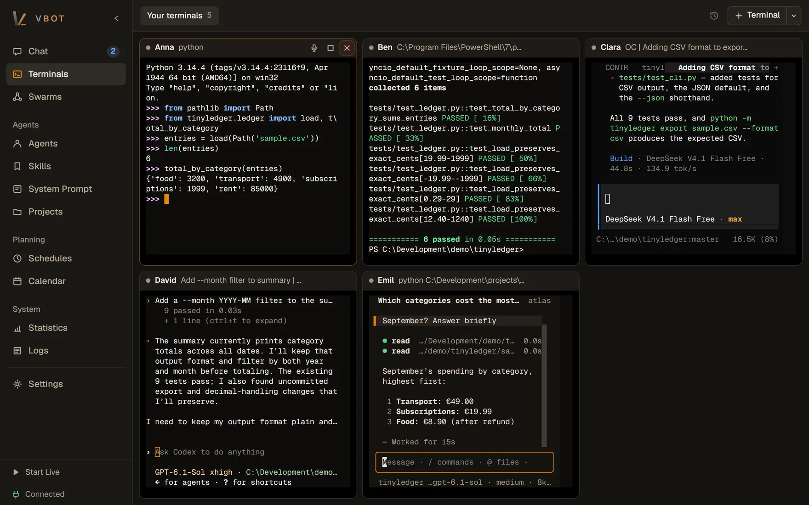
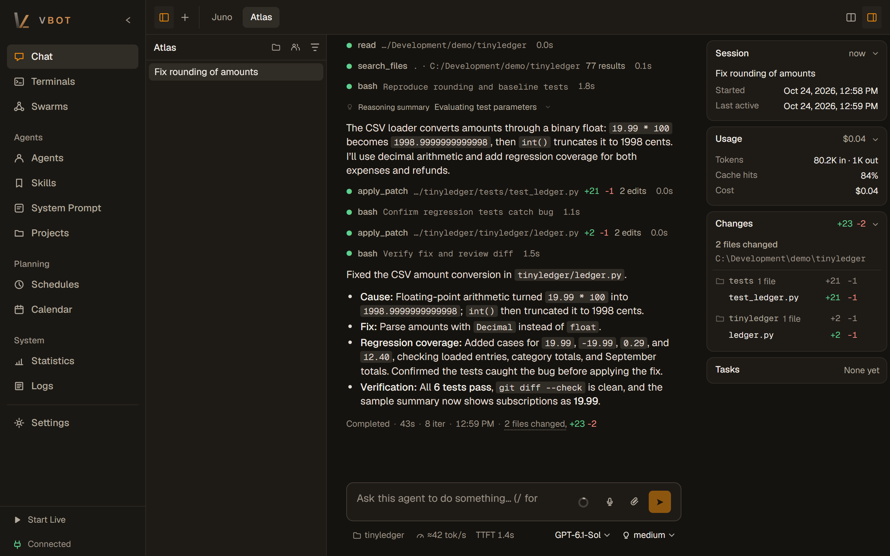
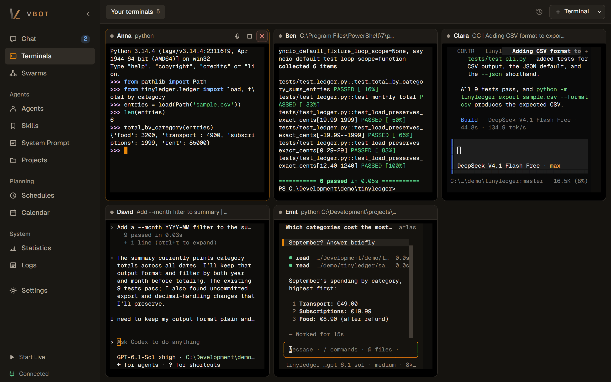
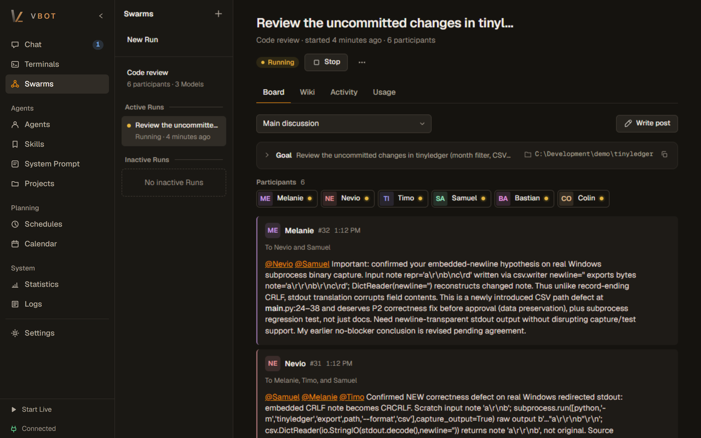
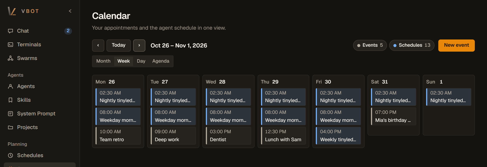

<p align="center">
  
</p>

<h1 align="center">vBot</h1>

<p align="center"><strong>Your own AI Agents, self-hosted.</strong></p>

<p align="center">
  Persistent Agents with Memory that work with you or on their own: in chat, in real terminals, in teams and swarms,
  on schedules and by voice. Use any Model, run everything on your own machine, and reach it from the browser,
  the Desktop app, the CLI or your messenger.
</p>

<p align="center">
  <a href="https://github.com/Vironnimo/vbot/releases"></a>
  <a href="LICENSE"></a>
  
  
</p>

<p align="center">
  <a href="#get-started">Get started</a> ·
  <a href="#what-you-get">Features</a> ·
  <a href="#a-closer-look">Screenshots</a> ·
  <a href="USAGE.md">User guide</a> ·
  <a href="#security">Security</a> ·
  <a href="https://github.com/Vironnimo/vbot/discussions">Discussions</a>
</p>

**Yours, on your own hardware.** Sessions, Memory, Agent state and credentials live in a data directory on your machine. vBot has no hosted service, no vBot account and no telemetry: it talks to the Model Providers and services you connect, and to GitHub when you update.

**More than a chat bot.** Your Agents work in real terminals next to Claude Code and Codex, as Swarms of many Agents on different Models, on schedules and from your voice, and you follow and steer all of it from one WebUI, the Desktop app, the terminal or your phone.

<p align="center">
  
</p>

## What you get

<table>
<tr>
<td width="50%" valign="top"><strong>Agents that remember</strong><br>Each Agent has its own personality, Memory, Skills, Model and Sessions, and picks up where you left off, also after a restart.</td>
<td width="50%" valign="top"><strong>Reachable everywhere</strong><br>WebUI, Desktop app, CLI with a full-screen terminal chat, Telegram, Discord, Slack, WhatsApp and Mattermost all reach the same Agents and Sessions. Agents can message you on their own.</td>
</tr>
<tr>
<td valign="top"><strong>Real terminals</strong><br>Run shells, REPLs, Claude Code, Codex, OpenCode or any other interactive program on the vBot server, watch from anywhere, and hand a terminal to an Agent.</td>
<td valign="top"><strong>Swarms</strong><br>Put a group of Agents on one goal. They split the work on a shared Board, keep a Wiki together and can each run on a different Model.</td>
</tr>
<tr>
<td valign="top"><strong>Work on their own</strong><br>Cron jobs on a schedule, at calendar events or when a webhook is called, a message Queue, Sub-Agents and recovery of interrupted Runs.</td>
<td valign="top"><strong>Live voice</strong><br>Talk to the app. A realtime voice Model starts terminals, passes tasks to your Agents, checks their status and tells you when a Run is done.</td>
</tr>
<tr>
<td valign="top"><strong>Projects</strong><br>Register a repository and work in it with your Agents. vBot picks up the agents, Skills and instructions the repository already has for Claude Code, Codex, OpenCode, GitHub Copilot, Cursor or Gemini CLI.</td>
<td valign="top"><strong>Any Model</strong><br>Sign in with ChatGPT, GitHub Copilot, SuperGrok, MiniMax or Nous Portal, use API keys for Anthropic, OpenRouter, Mistral, Ollama Cloud and more, or run Models locally with Ollama or LM Studio.</td>
</tr>
<tr>
<td valign="top"><strong>Under your control</strong><br>Permission Rules limit which folders an Agent may read or change, which commands it may run and which hosts it may reach. Agent Secrets let Agents use passwords and API keys without seeing them.</td>
<td valign="top"><strong>Extensible</strong><br>Files, shell, web, image and speech Tools, MCP servers, Computer Use, Home Assistant, KeePassXC and 1Password, and your own Extensions, allowed per Agent.</td>
</tr>
</table>

## Get started

Windows (normal, non-elevated PowerShell):

```powershell
irm https://raw.githubusercontent.com/Vironnimo/vbot/main/scripts/install.ps1 | iex
```

Linux on ARM64 or x86-64, including a Raspberry Pi with the 64-bit Raspberry Pi OS:

```bash
curl -fsSL https://raw.githubusercontent.com/Vironnimo/vbot/main/scripts/install.sh | bash
```

When the Installer reports that the server is running, open [http://127.0.0.1:22332/](http://127.0.0.1:22332/) and follow the setup guide to connect a Provider and choose a Model. The same Agents are also a command away in any terminal:

```bash
vbot tui                                    # full-screen chat with your Agents
vbot chat "What is on my calendar today?"   # one message, answer on stdout
```

The Installer downloads the signed package of the latest release, which brings its own Python runtime and WebUI, adds the `vbot` command, starts the server and sets it to start automatically: at sign-in on Windows, at boot through a systemd user service on Linux. `vbot update` installs new versions and keeps the previous one if a new version fails its startup check; `vbot uninstall` removes vBot. To follow the newest build of `main` instead of releases, install with `-Main` or `--main`. Prefer to read scripts before running them? Inspect [install.ps1](scripts/install.ps1) or [install.sh](scripts/install.sh) first. Desktop, remote-client and custom-port installations are covered in the [Installation guide](USAGE.md#installation).

## A closer look

### Agents that do the work

Ask in plain words and the Agent uses its Tools. Here Atlas finds out why a subscription shows up as 19.98 instead of 19.99, fixes the parsing, adds a regression test and runs the test suite. The Session panel next to the chat shows which files changed, what the Session cost and which Sub-Agents and tasks are running. Every Agent keeps its own Memory and Sessions, so you can continue the same conversation later from the WebUI, your phone, a messenger or `vbot tui` in a terminal.

<p align="center">
  
</p>

### Terminals on your vBot server

Terminals run on the machine that hosts the vBot server. The browser, the Desktop app or your phone only display them, so programs keep running when you close the tab. Here a Python REPL, a test run, OpenCode and Codex work in the same repository, next to vBot's own full-screen terminal chat.

When you step away, hand a terminal to an Agent: it attaches to the running program, reads the screen, answers questions, types the next instruction and reports back when the work is done. Agents can also start terminals of their own.

<p align="center">
  
</p>

### Swarms: many Agents, one goal

Give a Swarm a goal and a working directory. Every participant gets its own Session and Model; they coordinate on the Board, address each other directly and write their results into a shared Wiki. You follow along live and can step in with your own posts. Here six Agents on three different Models review a set of changes, split the areas between them and have just confirmed a newline bug in the new CSV export.

<p align="center">
  
</p>

### Scheduled and background work

Agents do not have to wait for you. From a single message, Juno put the week's appointments into the calendar and set up a morning briefing for every weekday and a weekly expense summary; Atlas runs the test suite every night and reports only failures. Cron jobs run on a schedule, at calendar events or when their webhook is called, and interrupted Runs are recovered after a restart.

<p align="center">
  
</p>

## Security

> **vBot Agents run with the operating-system permissions of the account that starts the server.** They can read and write files, run commands, contact external services and restart vBot. Trusted Extensions run inside the same process.

By default the server binds to `127.0.0.1` and admits only this computer. To use vBot from your phone or another computer at home, install it with the access mode `lan` (home network without login), which admits private networks and a VPN range you name, and keep restrictive firewall rules. To reach vBot over the internet, for example on a VPS or through a DynDNS name, use the access mode `authenticated`: it requires HTTPS, and every browser, Desktop or CLI signs in once by pairing with a code you approve. Never forward the port of a server without login to the public internet: network access to vBot amounts to remote code execution on the host. See [Server access](USAGE.md#server-access).

Permission Rules can confine an Agent to the folders, commands and hosts you choose, and Agent Secrets keep passwords out of what the Agent sees; neither is an operating-system sandbox. Credentials are encrypted in the data directory's Secret Store ([Credentials and the Secret Store](USAGE.md#credentials-and-the-secret-store)). Keep `~/.vbot` private; it holds Sessions and Agent state. See [Operational notes](USAGE.md#operational-notes).

## Documentation

| Goal | Start here |
|---|---|
| Install, update or remove vBot | [Installation](USAGE.md#installation) · [Updating and uninstalling](USAGE.md#updating-and-uninstalling) |
| Connect a Provider and choose a Model | [First-run setup](USAGE.md#first-run-setup) |
| Work with Agents, Projects, Sessions and Live voice | [Agents, Projects, and Sessions](USAGE.md#agents-projects-and-sessions) · [Full-screen terminal chat](USAGE.md#full-screen-terminal-conversations) |
| Restrict an Agent or give it passwords | [Agent settings](resources/skills/vbot-docs/references/agents.md#settings) · [Agent Secrets](resources/skills/vbot-docs/references/agent-secrets.md) |
| Configure Skills, Tools, Channels and schedules | [Skills and Tools](USAGE.md#skills-tools-and-sub-agents) · [Channels](USAGE.md#channels) · [Cron](USAGE.md#cron) |
| Use the Swarm, MCP, Computer Use and password manager Extensions | [Extension usage](resources/skills/vbot-docs/references/extension-usage.md) |
| Automate or integrate vBot | [CLI reference](USAGE.md#cli-reference) · [Server API](USAGE.md#server-api) |
| Build an Extension | [Extension authoring guide](resources/skills/vbot-docs/references/extensions.md) |
| Develop vBot itself | [Development and verification](USAGE.md#development-and-verification) |

## Project status

vBot is alpha software under active development. Back up `~/.vbot` before upgrades, expect interfaces to change between releases, and report problems through [GitHub Issues](https://github.com/Vironnimo/vbot/issues). Questions, ideas and show-and-tell belong in [Discussions](https://github.com/Vironnimo/vbot/discussions); [CONTRIBUTING.md](CONTRIBUTING.md) explains how to contribute and [SECURITY.md](SECURITY.md) how to report vulnerabilities privately.

If vBot is useful to you, a star on GitHub helps other people find it.

## License

Apache-2.0. See [LICENSE](LICENSE).
